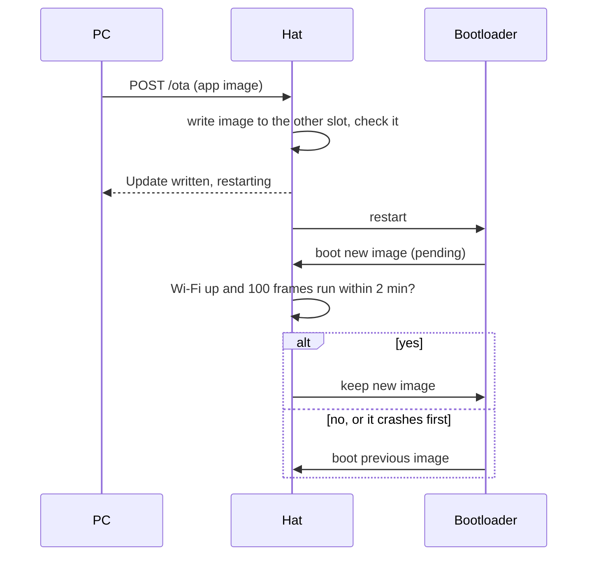
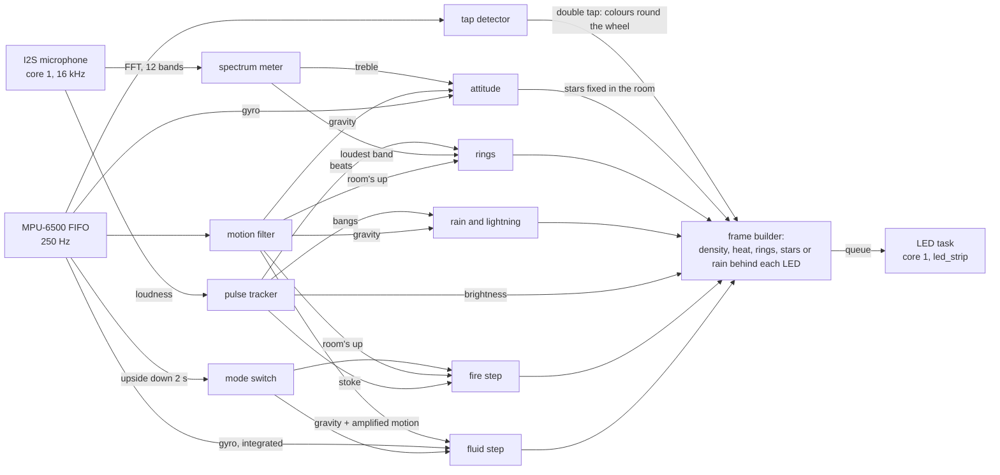

# Gravity hat (ESP-IDF)

Firmware for a hat of light: a WS2812B strip wound in a spiral round a
hat's crown shows a liquid inside it, flames, rings of sound, a night
sky or a thunderstorm, all following the hat's motion and the sound
around it.

It runs on an ESP32-WROOM-32 with an MPU-6500 IMU and an I2S
microphone, and is written in C for ESP-IDF 6.1. The physics is a port
of the fluid solver in [gravity-cube-rs](https://github.com/psytraxx/gravity-cube-rs).

## Modes

Hold the hat upside down for two seconds and it moves on to the next
mode: fluid, fire, rings, sky, storm, then the fluid again. A white arc
grows round the brim while the hat is held upside down, and the next
mode comes on when it closes; turn the hat back the right way up before
the next change.

A double tap turns the colours round the colour wheel, by at least 60°
each time, in every mode but the sky: the fluid takes a new hue, and the
fire, the rings and the rain turn their own colours as far round.


The animations here are rendered on a computer from the firmware's own
core code, over scripted motion and sound: the hat on the left, the
strip unrolled on the right.

### Fluid

A liquid fills the bottom half of the hat. Tilt the hat and the surface
tilts; shake it and the fluid sloshes; lay it on its side and it runs
along the low side. Its brightness pulses with the sound.


### Fire

Flames that always burn upwards in the room, whichever way the hat is
tilted: they lean round a tilted hat and burn from the crown when it is
upside down. Each beat and each jolt throws them up the hat; pressed
upwards they shoot higher, and in free fall they stall.


### Rings

Each beat sends a ring of light up the hat, always level with the floor
however the hat is tilted. The rings show two colours at a time; each
beat takes the colour of the loudest frequency band for one of the two,
so the colours change one at a time.


### Sky

Stars, the moon and now and then a shooting star, fixed in the room:
turn, tilt or nod and the sky stays where it is while the hat moves
under it. A quick spin smears the stars into streaks, and treble makes
them twinkle. The sky keeps its own colours.


### Storm

Rain running down the room over the hat's wall, slanting across it as
the hat tilts; a loud bang strikes lightning from the crown to the brim.


## Hardware

| Part | Notes |
|---|---|
| ESP32-WROOM-32 board | 4 MB flash |
| MPU-92/65 board | MPU-6500 (chip marked MP65), 3–5 V supply (on-board regulator), wired for SPI |
| WS2812B strip, 500 LEDs | Wound clockwise (seen from above) in a spiral of about 13 turns from the bottom up: 39 LEDs a turn at the bottom, 36.8 at the top, as the crown narrows |
| I2S microphone (e.g. INMP441) | On GPIO 32, 33 and 25; the modes follow its sound |
| 330 Ω resistor | In series with the data line, at the strip's input |
| 1000 µF capacitor or more | Across 5 V and GND at the strip's input (10 V or more) |
| 1N5819 Schottky diode | From the 5 V supply to the board's 5V pin, so USB cannot feed the strip or the supply |
| 5 V supply | Sized for the LEDs; the firmware keeps them dim (one channel at 60/255 or less) |

## Wiring


On the board's pins (a 38-pin ESP32-WROOM-32 board, its pins as printed
in its pinout picture):


### Power

The 5 V supply feeds the strip directly and the board through the
1N5819, anode on the supply, cathode (the band) on the board's 5V pin.
As a Schottky it drops about 0.3 V. With USB plugged in as well, the
diode keeps USB's 5 V out of the supply and the strip; the board then
runs from whichever is higher. The capacitor sits across 5 V and GND
where the supply meets the strip, + to 5 V. All grounds are common.

### LEDs

| ESP32 | Goes to |
|---|---|
| GPIO 13 | 330 Ω → DIN of the strip |

GPIO 13 sits next to GND and near 5V on the board's header, and has no
role at boot.

The ESP32 drives the data line at 3.3 V; WS2812B LEDs want about 3.5 V
at a 5 V supply. Most take 3.3 V; if the first LEDs flicker or show
wrong colours, add a 74AHCT125 level shifter.

### MPU-6500 (SPI)

The IMU uses the ESP32's VSPI pins, together on one side of the board:

| MPU-92/65 board | ESP32 |
|---|---|
| VCC | 3V3 |
| GND | GND |
| SCL (SCLK) | GPIO 18 (VSPI CLK) |
| SDA (SDI / MOSI) | GPIO 23 (VSPI MOSI) |
| AD0 (SDO / MISO) | GPIO 19 (VSPI MISO) |
| NCS | GPIO 5 (VSPI CS) |
| FSYNC | GND |
| EDA, ECL, INT | not connected |

FSYNC is unused and tied to GND so it does not float. EDA and ECL are an
auxiliary I2C bus for a magnetometer, and INT an interrupt line; the
firmware polls the FIFO instead.

SPI runs at 1 MHz, against 400 kHz for the board's I2C interface, so a
frame's FIFO read takes a fraction of the time. The pins are settable in
menuconfig. GPIO 5 is a strapping pin that has to be high at boot; NCS
idles high, so it is.

### I2S microphone

| Microphone board | ESP32 |
|---|---|
| VDD | 3V3 |
| GND | GND |
| SD | GPIO 32 (I2S data) |
| SCK | GPIO 33 (I2S bit clock) |
| WS | GPIO 25 (I2S word select) |
| L/R | GND (left channel) |

The three pins sit next to each other on the header, and none has a
role at boot; they are settable in menuconfig. The data line has the
ESP32's pull-down on, so with no microphone it reads silence and the
firmware keeps the fluid at full brightness. In WLED's
sound-reactive build the same wiring is `"digitalmic": {"type": 1,
"pin": [32, 25, 33, -1]}` (SD, WS, SCK, no MCLK), with the LEDs on
GPIO 13.

### The strip's geometry

The firmware places every LED from a few numbers in
[`main/core/config.h`](main/core/config.h); [Setting up a
hat](#setting-up-a-hat) shows how to read them off. For this hat:

| Setting | Value | |
|---|---|---|
| `HAT_LEDS_PER_TURN_BOTTOM` | 39 | LEDs in the bottom turn |
| `HAT_LEDS_PER_TURN_TOP` | 36.8 | LEDs in the top turn; fewer than at the bottom where the hat narrows |
| `HAT_ROW_PITCH` | 0.65 | Distance between two turns, divided by the distance between two LEDs along the strip |
| `HAT_LED_SPACING_MM` | 10 | Distance between two LEDs along the strip; sets how fast the fluid moves |
| `HAT_START_AT_TOP` | 0 | 1 if the data enters at the top turn |
| `HAT_CLOCKWISE` | 1 | 1 if the strip winds clockwise seen from above |

The LEDs per turn change evenly from bottom to top, so a hat that
narrows works too; from 39 down to 36.8 a turn, 500 LEDs make about
13 turns. The hat's radius at each height follows from its LEDs per turn
there. The grid round the hat (`FLUID_NX`, `FLUID_NY`, `FLUID_NZ`) has
to hold it: the host tests check, and fail if a new geometry needs a
bigger grid.

The IMU board lies flat in the hat's crown, chip side up, its X
arrow pointing any way round: *IMU rotation* in menuconfig says which,
and the firmware turns its readings into the hat's axes. Mounted on its
side or upside down, edit `MPU6500_AXIS_MAP` in
[`main/core/mpu6500_decode.h`](main/core/mpu6500_decode.h).

## Build and flash

ESP-IDF 6.1 ([install guide](https://docs.espressif.com/projects/esp-idf/en/v6.1/esp32/get-started/)):

```bash
idf.py build
```

```bash
idf.py -p /dev/ttyUSB0 flash monitor
```

Keep the hat still for the first second after power on: the gyro
calibrates its zero offset then.

The monitor logs a status line every 100 frames: acceleration,
rotation rate, sound level and brightness, and the physics, frame and
LED send times.

## Setting up a hat

The firmware has to know where every LED sits and how the IMU lies. For
a new hat, or after rewinding the strip:

1. **Count the strip.** Note:
   - the turn the data enters, bottom or top: `HAT_START_AT_TOP`;
   - which way the strip winds from there, seen from above:
     `HAT_CLOCKWISE`;
   - the LEDs in the bottom turn and in the top turn, counted round the
     hat: `HAT_LEDS_PER_TURN_BOTTOM`, `HAT_LEDS_PER_TURN_TOP`;
   - the distance between two rows over the distance between two LEDs
     along the strip: `HAT_ROW_PITCH`;
   - 1000 over the strip's LEDs per metre: `HAT_LED_SPACING_MM`.

   Set them in [`main/core/config.h`](main/core/config.h) and run the
   host tests (they fail if the grid needs to grow).
2. **Calibration picture on.** In `idf.py menuconfig` → *Gravity hat*,
   turn on *Calibration picture instead of the fluid*, then build and
   flash. Updates over Wi-Fi keep working, so the steps below can be
   flashed over the network.
3. **Straighten the lines.** Four lines run up the hat, one LED per
   turn: red at LED 0's angle, then green, blue and yellow a quarter turn
   apart, counter-clockwise seen from above. Where the LEDs per turn are
   not a whole number they step half an LED from side to side; past that
   they should stand straight. Follow a line from LED 0's end: where it
   drifts the way the strip runs, the LEDs per turn set there are too
   many; where it drifts against it, too few. Drift that grows only
   towards the far end means the far turns are shorter or longer than
   the near ones: change the count at that end. Over 13 turns, 0.1 LED
   more a turn at one end moves the far end of the line about 0.65 LEDs,
   at both ends about 1.3. Counting by hand is seldom exact; a few rounds
   of looking at the lines settle it.
4. **Mount the IMU and set its rotation.** Lay the board flat in the
   hat's crown, chip side up, its X arrow pointing any way round.
   Tilt the hat and a white band lights the side the firmware takes for
   low. With *IMU rotation* set to 0, tip the hat so that LED 0's side
   (the red line) is lowest: the band lights the side the setting points at,
   a quarter turn per line, counter-clockwise seen from above: on the
   green line 90, on the blue 180, on the yellow 270, in between in
   between. The monitor logs it exactly as `low side at N deg` (add 360
   if N is negative). Set *IMU rotation* to it, flash, and the band
   follows every tilt: red side down lights the red line, green side
   down the green. If the band moves the right way for one tilt but the
   wrong way for the other, the board is mirrored, which a right-way-up
   board cannot be: check it lies chip side up.
5. **Calibration picture off.** Build and flash: the fluid.

This hat came out at LED 0 on the brim, winding clockwise, 39 LEDs a
turn at the brim and 36.8 at the top (straightened with the lines), rows
0.65 LED spacings apart, and an IMU rotation of 90°, the default.

## Updates over Wi-Fi

Once the hat has been flashed over USB with a Wi-Fi SSID set, it takes
new firmware over the network. Set the SSID and password (and, ideally,
an update token) in `idf.py menuconfig` → *Gravity hat* → *Wi-Fi and
firmware updates*, flash over USB once, then for every update:

```bash
idf.py build
```

```bash
curl -H "Authorization: Bearer $TOKEN" \
     --data-binary @build/gravity-hat.bin http://hat.local/ota
```

`curl http://hat.local/` shows the running version (from `git
describe`) and app slot. If `hat.local` does not resolve, use the IP
address the monitor logs once Wi-Fi is up.



The 4 MB flash has two 1984 KB app slots ([`partitions.csv`](partitions.csv)):
the running firmware writes the new image into the other one and boots
it. A new image only stays if it gets onto the network and runs the main
loop for 100 frames within two minutes; if not, or if it crashes first,
the bootloader goes back to the previous image. So a broken build cannot
cut the hat off from further updates, but one built with no SSID turns
updates off for good, until the next USB flash.

Wi-Fi, the network stack and the update server run on core 1, next to
the LED task, so the physics on core 0 keeps its time. Flash writes
pause both cores for moments at a time, so the fluid stutters for the
few seconds an update takes.

Without a token, anyone on the network hat reflash the hat.

## Settings

`idf.py menuconfig` → *Gravity hat*:

| Setting | Default | |
|---|---|---|
| LED data GPIO | 13 | |
| Physics step period | 18 ms | The physics constants are per step |
| Calibration picture | off | Instead of the fluid: lines for the geometry, a band for the IMU; see [Setting up a hat](#setting-up-a-hat) |
| Tap threshold | 1000 mg | Raise it if sloshing changes the colour, lower it if taps are missed |
| IMU SPI pins | 23, 19, 18, 5 | MOSI, MISO, SCLK, CS |
| IMU rotation | 90° | Where LED 0's side lies seen from the IMU board's X arrow, counter-clockwise; see [Setting up a hat](#setting-up-a-hat) |
| Listen to the sound | on | Reads the I2S microphone: the fluid's brightness, the fire, rings, stars and lightning follow it |
| Microphone pins | 32, 33, 25 | SD, SCK, WS |
| Brightness in the quiet | 25 % | Loud sounds pulse it up to full |
| Wi-Fi SSID, password | empty | Network for updates over Wi-Fi; an empty SSID turns Wi-Fi off |
| Hostname | hat | Answers at `http://hat.local/` |
| Update token | empty | Updates need `Authorization: Bearer <token>`; empty lets anyone on the network update |

The strip's geometry and the fluid's colour are in
[`main/core/config.h`](main/core/config.h).

## How it works



**Core 0** reads every IMU sample since the last frame, runs one physics
step and builds the frame. **Core 1** sends frames to the strip with
Espressif's [led_strip](https://components.espressif.com/components/espressif/led_strip)
component over RMT (~15 ms for 500 LEDs); the two overlap, and core 0
only waits if core 1 is still sending. Unchanged frames are not re-sent,
so a settled hat in the quiet, or with no microphone, keeps the data
line quiet.

**IMU.** The MPU-6500 samples accelerometer (±4 g) and gyro (±1000 °/s)
at 250 Hz into its FIFO. Each frame uses the mean acceleration and the
gyro integrated over all samples since the last frame.

**Motion filter.** A complementary filter tracks gravity: the gyro turns
the estimate as the hat tilts, and the accelerometer slowly corrects it.
Whatever acceleration is left over is the hat's own motion, and is
tripled before reaching the fluid, so shaking sloshes it but tilting does
not overshoot.

**Double tap.** The MPU-6500 has no tap engine outside its DMP, so taps
are found in software on the raw samples: a jump of more than the
threshold between two samples, after at least 30 ms of stillness, counts
as a tap; a second tap within 375 ms picks a random hue at least 60°
from the current one. Shaking never has the stillness, so it does not
change the colour. The fluid takes the new hue; the fire, the rings and
the rain turn their own colours as far round the wheel as the fluid's
has turned from its green at power on, so the fire starts red, orange
and yellow and the rain blue. The sky keeps its own colours. Every
hue's channels add up to 60/255, so the strip draws the same current in
any colour.

**Sound.** A task on core 1 reads the microphone at 16 kHz (24-bit
samples in 32-bit slots, both slots, so the L/R pin may go either way)
and keeps the RMS of the latest 20 ms, its DC removed. Each frame turns
that into a level in dB and places it between two followers: the floor,
the quiet between sounds (it drops at once to a quieter level and creeps
up 3 dB a second through louder ones), and the peak, the loud parts (it
jumps at once and sinks 6 dB a second, staying at least 12 dB above the
floor). A level 3 dB over the floor starts to count; at the peak it
counts in full. The pulse jumps to that share at once and fades with a
150 ms time constant, and the brightness runs from the quiet setting
(25 %) at no pulse to full at a full one. So a clap in a quiet room
flashes the fluid, steady noise settles back to dim within seconds, and
beats over loud music still pulse.

**Modes.** Each frame the mean acceleration says whether the hat is
upside down: gravity more than 0.7 g towards its crown, within about
45° of crown down. Two seconds of that in a row switch to the next
mode; the hat then has to point at least 0.3 g the right way up again
before it can switch once more, so holding it upside down for longer
switches only once. Only the mode on show runs; the fluid waits where it
is while the fire burns.

**Fire.** Heat lives on a grid of 40 × 28 points wrapped round the
hat's wall. Each step it is carried along the wall the way the room's up
runs there: up (against the motion filter's acceleration, smoothed) is
projected onto the wall, so upright the flames climb from the brim,
tilted they lean round towards the high side, and upside down they climb
from the crown towards the brim. Where the wall leans, the gas still
rises at the square root of its share of the speed, so on a hat lying on
its side the flames get away from the low side and rise round it both
ways. Fuel burns past the wall's edge the gas comes in from and along
the wall's lowest part in the room, with a random flicker per column;
the heat then loses a share and a random amount each step, so flames
lick up and break off.

The flames follow the hat's motion and the sound. Up is smoothed only a
little, so they lean into a sideways shove at once, as a helium balloon
in a car leans forwards when it speeds up. The gas rises as fast as the
acceleration the hat feels (up to 2.5 g): pressed upwards the flames
shoot higher, and tossed into free fall they stall and hang. A beat (the
sound's pulse, squared, so the beat itself counts and its fading tail
does not) or a jolt (a change of 1.2 g between two frames fans it like a
full beat) stokes the fire: more fuel, gas rising up to 1.9 times as
fast, and up to 50 % less random cooling. Quiet flames reach about a
quarter of the way up; a beat lifts them to about nine tenths of the
hat within about 0.2 s, and they fall back before the next one at
120 bpm. Heat runs from dark through deep red to orange and yellow (the
hue turning 54° from the coolest to the hottest flames), at no more than
the fluid's 60/255 a LED.

**Spectrum.** The microphone task keeps the latest 512 samples (32 ms)
and, for every 20 ms it reads, takes their FFT through a Hann window and
sums the power into 12 bands spaced evenly in pitch from 60 Hz to
7 kHz. Each band has its own floor, the quiet in that band, which drops
at once and creeps up 3 dB a second, so a hum or the steady bass under
music sinks back; the loudest band over its floor sets one shared peak,
which jumps up and sinks 6 dB a second. Each band's level runs from 0
at its floor to 1 at the peak, jumps up at once and falls 1.5 a second.
The rings take the hue of the loudest band (red for the bass to violet
for the treble), and the stars twinkle with the top quarter of the
bands.

**Rings.** A beat is the sound's pulse jumping a quarter or more above
its lowest point since the last beat, at most one every 0.15 s: loud
music never lets the pulse fall far, but each beat still jumps out of
it. A beat starts a ring at the hat's lowest point in the room, as
strong as the pulse. The rings take turns between the two colours of a
palette; each beat sets its colour to the loudest spectrum band's at
that moment, turned as far round the wheel as the double taps have
turned the fluid, and the rings in flight in that colour change with it.
So the hat shows two colours at most, and each beat changes one of them
at most. Each LED lights by how close its height in the room (its
place on the wall, along the motion filter's up) is to each ring, so the
rings stay level whichever way the hat is tilted. A ring rises 0.12 to
0.24 cells a step, louder ones faster and thicker, dims to a third as it
climbs, and leaves at the top; up to 8 are in flight at once, adding up
to no more than the fluid's power on any LED.

**Sky.** The attitude tracks how the hat lies in the room as a
quaternion: the gyro turns it every frame, and each frame it is pulled
4 % of the way towards the motion filter's gravity, so up stays up. The
heading round the room's up has nothing to correct it, so it drifts by
the gyro's leftover zero offset, a fraction of a degree a second. 38 stars (placed by a seeded generator)
and a moon sit at fixed directions; each LED looks out from the hat's
middle through its place on the wall, turned into the room by the
attitude, and lights as that direction nears a star (about 3° across)
or the moon (about 13°). Each LED keeps an afterglow that loses 70 % a
frame when the hat is still and only 18 % when it turns faster than
about 1.7 turns a second, so a quick spin smears the stars into
streaks. The treble's level makes each star's brightness jitter by up
to 80 %, and about once every 1.5 s a gold shooting star crosses.

**Storm.** 45 drops slide along the wall the way gravity points there
(the fire's up the other way round), at up to 0.3 cells a step, leaving
a streak on a 40 × 28 grid wrapped round the wall that loses 45 % a
step. The rain is blue (hue 215°) at two thirds of the fluid's power,
turned round the wheel by double taps; the lightning is white. A drop that leaves the wall starts again at the edge the rain
comes in from, anywhere when the hat lies on its side. A bang is a level
15 dB or more over its slow average (one second's time constant), at
most one every 0.36 s: it strikes a jagged bolt along the wall from the
edge the rain comes in from to the other, with a branch now and then,
and a faint flash over the whole hat. The bolt flickers and fades
within a third of a second.

**Fluid.** An incompressible FLIP fluid: inviscid Navier-Stokes on a
staggered grid of 9 × 9 × 7 cells, each 1.4 LED spacings across, about
2 rows high (coarser cells would look blockier, finer ones cost too
much time on an ESP32). The hat is the cells whose centres lie within
its radius at their height and below its top: 7 layers of 61 cells,
narrowing to 57 at the top, as round as cells that size allow; its
walls are their outer faces. Faces with no cell of the hat on either
side take no part, as faces beyond the grid's edge do. Each step the
particles take gravity and the forces of the turning hat (Euler,
Coriolis, centrifugal), hand their velocity to the grid, and a
Gauss-Seidel pressure solve (60 passes) makes the flow divergence-free
against the walls. The particles take back the change (80 % FLIP, 20 %
PIC to damp noise), move, and are pushed apart so they stay evenly
spread; cells packed above two particles get a little outflow, so the
fluid keeps its volume. About 370 particles fill the bottom half.

The fluid's hat is closed and narrow, so shoving it sideways only
presses on the fluid: it moves where it has a free surface to move into. Spun about
its axis, the fluid mostly stays put while the hat turns round it, as
liquid in a glass does at first.

**LEDs.** Each LED's place on the spiral follows from its index: the
LEDs per turn change evenly from 39 at the bottom to 36.8 at the top, so
LED *i* sits where the LEDs counted so far reach *i*, clockwise from
LED 0 and climbing a row a turn, on the circle of the hat's radius at
that height. It shows the fluid half a cell inside the wall in front of
it, blended from the nearest cell centres: it lights once the density
there reaches 1.0 and goes dark below 0.4, so a still surface does not
flicker. Because the spiral climbs a little
with every LED, a tilted surface shows as a smooth slanted line rather
than steps.

## Code layout

| Path | |
|---|---|
| `main/main.c` | Main loop on core 0, LED task on core 1, calibration picture |
| `main/ota.c` | Wi-Fi, mDNS and the update server on core 1; keeps or rolls back a new image |
| `main/mpu6500.c` | MPU-6500 over SPI: setup, gyro calibration, FIFO reads |
| `main/mic.c` | I2S microphone on core 1: the loudness of the latest 20 ms and the spectrum of the latest 32 ms |
| `main/ws2812.c` | The strip through the `espressif/led_strip` component (RMT) |
| `main/core/` | Everything that needs no hardware: the hat's numbers (`config.h`) and shape (`shape.h`), modes and the switch between them, fluid, fire, spectrum bands, rings, attitude and sky, storm, frames, LED spiral and calibration picture, colours, motion filter, tap detector, sound pulse, IMU sample decoding and batching |
| `test/host/` | Unity tests for `main/core`, run on the host |

## Tests

The core has host tests (plain CMake and Unity, no ESP-IDF):

```bash
cmake -S test/host -B build-host && cmake --build build-host
```

```bash
ctest --test-dir build-host --output-on-failure
```

CI runs them and builds the firmware for the ESP32 on every pull request
and every push to `main`.
